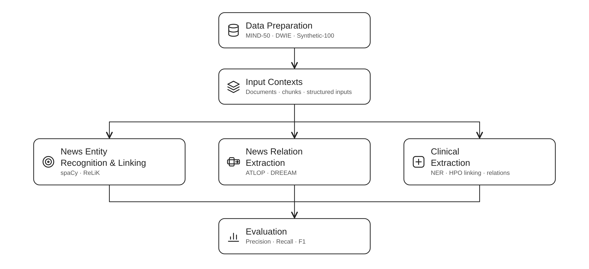

# Knowledge Graph Construction

Code for entity recognition, entity linking, and relation extraction on news and clinical text.



Read the [online documentation](https://mt-docs.pages.dev/knowledge-graph/) for the user guide and API reference.

See [SETUP.md](SETUP.md) for installation, data downloads, model paths, and parameter examples.

The experiments study how input boundaries affect extraction: whole articles, predicted topic segments, fixed-length chunks, sentences, and clinical blocks and sections.

- **News:** MIND-50 and DWIE, using spaCy with spaCy-entity-linker, ReLiK, ATLOP, and DREEAM.
- **Clinical:** Synthetic-100, using GLiNER-Relex, HunFlair2, MedCAT, PhenoBERT, FastHPOCR, SapBERT, and GLiREL.

News segmentation uses the model from [`topic_segmentation/`](../topic_segmentation/README.md). Clinical experiments use the reference blocks and sections supplied with the notes.

## Quick start

Follow [installation](SETUP.md#installation) and place the [MIND-50 files](SETUP.md#mind-50) in `data/mind50/`. Then run spaCy from the repository root:

```bash
cd knowledge_graph
source scripts/activate.sh

python -m knowledge_graph.news.entity_linking --backend spacy \
    --input data/mind50/mind_nerl_gold_qid.json \
    --out runs/news/example/spacy_document.json
```

This example runs on CPU. The linker downloads its Wikidata database on first use.

Run the remaining commands from `knowledge_graph/`, with the environment activated. Add `--help` to a Python command to see its options.

## Extract entities and links from your own articles

Save a JSON object containing `documents`, with an `id` and `text` for each article:

```json
{"documents": [{"id": "article_1", "text": "Microsoft opened an office in Zurich."}]}
```

Use spaCy with spaCy-entity-linker:

```bash
python -m knowledge_graph.news.entity_linking --backend spacy \
    --input articles.json --out runs/news/articles_spacy.json
```

Or ReLiK, which requires a CUDA GPU:

```bash
python -m knowledge_graph.news.entity_linking --backend relik \
    --input articles.json --out runs/news/articles_relik.json
```

The output contains the input documents and their entities with character offsets (`begin`, `end`): spaCy entities carry Wikidata IDs (`wikidataId`), ReLiK entities Wikipedia titles (`wikipedia_title`).

To process predicted topic segments, add `--segments predictions.jsonl`. The [segmentation output](../topic_segmentation/README.md#input-and-output) must use the same article IDs.

See [Code structure](docs/ARCHITECTURE.md#python-use) for Python usage and adapter interfaces.

## Reproduce the thesis experiments

Run from `knowledge_graph/` with the environment activated and [data and weights](SETUP.md#data-and-weights) in place. To prepare inputs, run the saved news models, and score their predictions:

```bash
bash scripts/news.sh all runs/news/rerun
```

To include ATLOP and DREEAM training:

```bash
bash scripts/news.sh reproduce runs/news/rerun
```

The pipeline writes inputs, predictions, and scores under the selected output directory. `reproduce` uses the models trained there; `all` skips training and uses the [configured relation models](SETUP.md#relation-models).

The separate 2,048-subword single-pass RE checkpoints use the [Python inference command](SETUP.md#relation-models) with `--single-pass-2048`.

See [individual stage commands](SETUP.md#run-commands) for news stages and clinical NER, HPO linking, and relation extraction. Clinical experiments share an 80/10/10 split of Synthetic-100 and compare released and adapted models on the ten test notes.

## Folder structure

```
knowledge_graph/
├── scripts/                    # environment and news pipeline
├── src/knowledge_graph/
│   ├── news/                   # news data, extraction, training, and scoring
│   ├── clinical/               # clinical data, extraction, training, and corpus construction
│   ├── common.py               # shared I/O, metrics, and checkpoint selection
│   └── paths.py                # dataset and output locations
├── data/                       # datasets, annotations, and ontology resources
├── checkpoints/                # downloaded model weights
└── runs/                       # trained models, predictions, and scores
```

## Third-party code

- [`news/atlop.py`](src/knowledge_graph/news/atlop.py): [ATLOP](https://github.com/wzhouad/ATLOP); no license stated upstream.
- [`news/dreeam.py`](src/knowledge_graph/news/dreeam.py): [DREEAM](https://github.com/YoumiMa/dreeam); MIT license.
- [`clinical/vendor/phenobert/`](src/knowledge_graph/clinical/vendor/phenobert/): [PhenoBERT](https://github.com/EclipseCN/PhenoBERT), MIT license. Its bundled [fastNLP](https://github.com/fastnlp/fastNLP/tree/v0.4.10) components use Apache-2.0.
- [`news/relik_loading.py`](src/knowledge_graph/news/relik_loading.py): a compatibility adapter containing a [Transformers](https://github.com/huggingface/transformers) pooling head, Apache-2.0.

ATLOP and DREEAM provide the encoder, loss, and model code. Their shared feature preparation and batching are in [`news/docred.py`](src/knowledge_graph/news/docred.py).

## Citations

```bibtex
@inproceedings{zhou2021atlop,
  author       = {Wenxuan Zhou and
                  Kevin Huang and
                  Tengyu Ma and
                  Jing Huang},
  title        = {Document-Level Relation Extraction with Adaptive Thresholding
                  and Localized Context Pooling},
  booktitle    = {Proceedings of the AAAI Conference on Artificial Intelligence},
  volume       = {35},
  number       = {16},
  pages        = {14612--14620},
  year         = {2021},
  url          = {https://ojs.aaai.org/index.php/AAAI/article/view/17717},
  doi          = {10.1609/aaai.v35i16.17717}
}

@inproceedings{ma-etal-2023-dreeam,
  author       = {Youmi Ma and
                  An Wang and
                  Naoaki Okazaki},
  title        = {{DREEAM}: Guiding Attention with Evidence for Improving
                  Document-Level Relation Extraction},
  booktitle    = {Proceedings of the 17th Conference of the European Chapter
                  of the Association for Computational Linguistics},
  pages        = {1971--1983},
  publisher    = {Association for Computational Linguistics},
  year         = {2023},
  url          = {https://aclanthology.org/2023.eacl-main.145/},
  doi          = {10.18653/v1/2023.eacl-main.145}
}

@inproceedings{orlando-etal-2024-relik,
  author       = {Riccardo Orlando and
                  Pere-Llu{\'i}s Huguet Cabot and
                  Edoardo Barba and
                  Roberto Navigli},
  title        = {{ReLiK}: Retrieve and LinK, Fast and Accurate Entity Linking
                  and Relation Extraction on an Academic Budget},
  booktitle    = {Findings of the Association for Computational Linguistics: ACL 2024},
  pages        = {14114--14132},
  publisher    = {Association for Computational Linguistics},
  year         = {2024},
  url          = {https://aclanthology.org/2024.findings-acl.839/},
  doi          = {10.18653/v1/2024.findings-acl.839}
}

@article{feng2022phenobert,
  author       = {Yuhao Feng and
                  Lei Qi and
                  Weidong Tian},
  title        = {{PhenoBERT}: A Combined Deep Learning Method for Automated
                  Recognition of Human Phenotype Ontology},
  journal      = {IEEE/ACM Transactions on Computational Biology and Bioinformatics},
  volume       = {20},
  number       = {2},
  pages        = {1269--1277},
  year         = {2023},
  url          = {https://doi.org/10.1109/TCBB.2022.3170301},
  doi          = {10.1109/TCBB.2022.3170301}
}

@article{ZAPOROJETS2021102563,
  author       = {Klim Zaporojets and
                  Johannes Deleu and
                  Chris Develder and
                  Thomas Demeester},
  title        = {{DWIE}: An entity-centric dataset for multi-task
                  document-level information extraction},
  journal      = {Information Processing and Management},
  volume       = {58},
  number       = {4},
  pages        = {102563},
  year         = {2021},
  url          = {https://doi.org/10.1016/j.ipm.2021.102563},
  doi          = {10.1016/j.ipm.2021.102563}
}

@inproceedings{DBLP:conf/acl/WuQCWQLLXGWZ20,
  author       = {Fangzhao Wu and
                  Ying Qiao and
                  Jiun{-}Hung Chen and
                  Chuhan Wu and
                  Tao Qi and
                  Jianxun Lian and
                  Danyang Liu and
                  Xing Xie and
                  Jianfeng Gao and
                  Winnie Wu and
                  Ming Zhou},
  title        = {{MIND:} {A} Large-scale Dataset for News Recommendation},
  booktitle    = {Proceedings of the 58th Annual Meeting of the Association for Computational
                  Linguistics, {ACL} 2020, Online, July 5-10, 2020},
  pages        = {3597--3606},
  publisher    = {Association for Computational Linguistics},
  year         = {2020},
  url          = {https://doi.org/10.18653/v1/2020.acl-main.331},
  doi          = {10.18653/V1/2020.ACL-MAIN.331}
}
```
