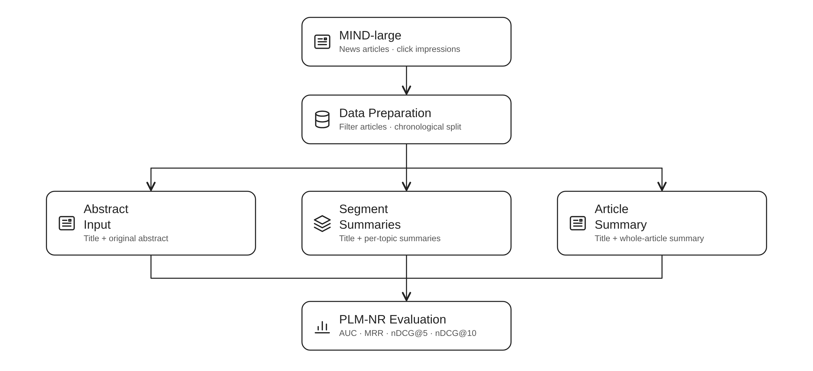

# News Recommendation

Code for comparing news article representations with PLM-NR.



Read the [online documentation](https://mt-docs.pages.dev/recommendation/) for the user guide and API reference.

See [SETUP.md](SETUP.md) for installation, data downloads, model paths, and parameter examples.

The experiments compare three article representations using the same ranking architecture, training settings, and chronological data split.

| Representation | Article input (512 BERT tokens) |
|---|---|
| `title_abstract_512` | Title and original abstract |
| `title_section_summary_512` | Title and summaries of predicted topic segments |
| `title_article_summary_512` | Title and a generated whole-article summary |

## Quick start

Follow [installation](SETUP.md#installation) and supply the [data and weights](SETUP.md#data-and-weights), then rebuild the saved experiment inputs from the repository root:

```bash
cd recommendation
source scripts/activate.sh

python -m news_recommendation.pipeline replay --output runs/replay
```

This step runs on CPU. `replay` rebuilds the split and packs the saved segmentation, summaries, and segment selection into `runs/replay/data/`.

## Reproduce the thesis experiments

Run from `recommendation/` with the environment activated. Train and evaluate all three representations using the inputs prepared above:

```bash
python scripts/run_training.py --data runs/replay/data --gpus 0 1 2 3 --output-dir runs/reproduction
```

The launcher trains each representation separately and evaluates the epoch with the best validation AUC. Runs save model weights, configuration, validation metrics in `epochs.json`, and test AUC, MRR, nDCG@5, and nDCG@10 in `test.json`. Existing results are protected from overwriting.

To inspect the segment-summary results:

```bash
cat runs/reproduction/title_section_summary_512/test.json
```

Training settings are in [configs/plm_nr.json](configs/plm_nr.json). See [run commands](SETUP.md#run-commands) to select one representation or regenerate segmentation and summaries.

## Folder structure

```text
recommendation/
├── configs/                   # experiment settings, paths, and summary prompts
├── scripts/                   # environment and training commands
├── src/news_recommendation/   # data preparation, summaries, ranking, and scoring
├── generation/                # summary-generation environment
├── data/                      # MIND articles, impressions, and prepared inputs
├── checkpoints/               # downloaded model weights
└── runs/                      # trained models, predictions, and scores
```

## Third-party code

The PLM-NR model is adapted from [wuch15/PLM4NewsRec](https://github.com/wuch15/PLM4NewsRec) by Chuhan Wu and colleagues. The upstream repository does not state a license.

## Citations

```bibtex
@inproceedings{DBLP:conf/sigir/WuWQ021,
  author       = {Chuhan Wu and
                  Fangzhao Wu and
                  Tao Qi and
                  Yongfeng Huang},
  title        = {Empowering News Recommendation with Pre-trained Language Models},
  booktitle    = {Proceedings of the 44th International ACM SIGIR Conference
                  on Research and Development in Information Retrieval},
  pages        = {1652--1656},
  publisher    = {ACM},
  year         = {2021},
  url          = {https://doi.org/10.1145/3404835.3463069},
  doi          = {10.1145/3404835.3463069}
}

@inproceedings{DBLP:conf/acl/WuQCWQLLXGWZ20,
  author       = {Fangzhao Wu and
                  Ying Qiao and
                  Jiun{-}Hung Chen and
                  Chuhan Wu and
                  Tao Qi and
                  Jianxun Lian and
                  Danyang Liu and
                  Xing Xie and
                  Jianfeng Gao and
                  Winnie Wu and
                  Ming Zhou},
  title        = {{MIND:} {A} Large-scale Dataset for News Recommendation},
  booktitle    = {Proceedings of the 58th Annual Meeting of the Association for Computational
                  Linguistics, {ACL} 2020, Online, July 5-10, 2020},
  pages        = {3597--3606},
  publisher    = {Association for Computational Linguistics},
  year         = {2020},
  url          = {https://doi.org/10.18653/v1/2020.acl-main.331},
  doi          = {10.18653/V1/2020.ACL-MAIN.331}
}
```
