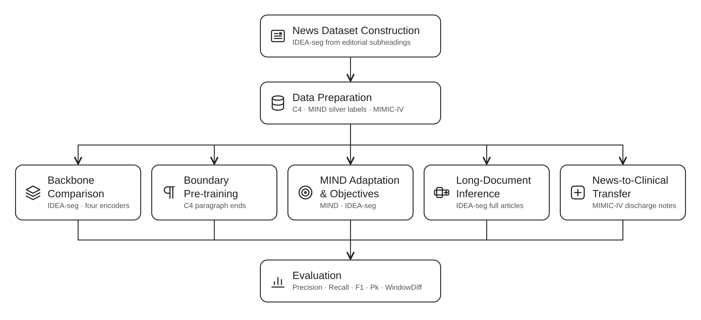

# Topic Segmentation

Code for news topic segmentation and transfer to clinical notes.



Read the [online documentation](https://mt-docs.pages.dev/topic-segmentation/) for the user guide and API reference.

See [SETUP.md](SETUP.md) for installation, downloads, and parameter examples.

The models mark section boundaries between paragraphs or sentences.

The final model uses ModernBERT-base with C4 boundary pre-training, MIND adaptation (25k articles, teacher labels, all objectives), and IDEA-seg fine-tuning.

## Quick start

Follow [installation](SETUP.md#installation), then run the Chonkie baseline on CPU from the repository root:

```bash
cd topic_segmentation
source scripts/activate.sh

hf download mirth/chonky_modernbert_base_1 --local-dir checkpoints/baselines/chonkie/neural-modernbert-base
python -m topic_segmentation.inference --model-type chonkie_neural --input data/sample_input.jsonl --device cpu
```

## Segment your own articles

Replace `data/sample_input.jsonl` with your input file. Use `--model` to load a different checkpoint.
For ModernBERT and NeuralChunker, select a device with `--device cpu` or `--device cuda:1`.

### ModernBERT (default)

Place the trained weights in `runs/mind_adaptation/mind_25k_full_news_ts`.

```bash
python -m topic_segmentation.inference --model-type modernbert_ts --input data/sample_input.jsonl
```

- `--window`: tokens per window (default: 1024).
- `--stride`: tokens between window starts (default: 512).
- `--no-protect-window-end`: allow section boundaries at window ends.

### Chonkie SemanticChunker

Segments by embedding similarity. Weights: `checkpoints/baselines/chonkie/semantic-potion-base-32m`.

```bash
python -m topic_segmentation.inference --model-type chonkie_semantic --input data/sample_input.jsonl
```

### Chonkie NeuralChunker

Weights: `checkpoints/baselines/chonkie/neural-modernbert-base`.

```bash
python -m topic_segmentation.inference --model-type chonkie_neural --input data/sample_input.jsonl
```

### Input and output

JSONL, one article per line. Example: [`data/sample_input.jsonl`](data/sample_input.jsonl).

```json
{"articleId": "doc_42", "sentences": ["First sentence.", "Second sentence.", "Third sentence."], "labels": [1, 0, 1]}
```

- `sentences`: list of sentences.
- `articleId`: optional; defaults to the line index, starting at 0.
- `labels`: optional; `1` = section ends here, `0` = section continues.

With labels, evaluation reports precision, recall, F1, Pk, and WindowDiff. The final sentence always gets `1` and is excluded from scoring.

Output fields: `articleId`, `sentences`, and `predictions` (0/1). Use `--output` to choose the file path. The default is `runs/long_document_inference/<model type>_<input>_<time>.jsonl`.

## Reproduce the thesis experiments

Experiment settings are in `configs/`. Supply the IDEA-seg splits in `data/news/` and `data/news_sent/`, then run from `topic_segmentation/`:

```bash
source scripts/activate.sh                # activate the environment
bash scripts/run_ts_pipeline.sh --dry-run # preview all stages
bash scripts/run_ts_pipeline.sh           # run all stages
```

Set GPU IDs and experiment groups in `scripts/run_ts_pipeline.sh`. Stage scripts accept `--dry-run` to print commands and `--help` to list options.

The pipeline writes to `runs/<stage>/reproductions/<time>/` and passes each new checkpoint to the stages that use it. Shared models train once. MIND silver labels go in the current MIND run's `data/` folder.

The pipeline covers data preparation, C4 boundary pre-training, news fine-tuning, MIND adaptation, long-document inference, and clinical transfer. See [individual stage commands](SETUP.md#run-commands) and [checkpoint handoffs](SETUP.md#using-reproduced-checkpoints) to run these separately. Individual commands use configured inputs unless you pass newly trained checkpoints explicitly.

News, MIND, and clinical training save settings and test scores in `results.jsonl` beside run folders. Inference saves settings and available scores beside the prediction file.

## Folder structure

```
topic_segmentation/
├── configs/                 # experiment settings and paths
├── scripts/                 # commands to run each stage
├── src/topic_segmentation/  # data preparation, models, training, inference, scoring
├── data/                    # datasets and sample input
├── checkpoints/             # downloaded model weights
├── cache/                   # temporary and cached files
└── runs/                    # trained models, predictions, and scores
```

## Citations

```bibtex
@inproceedings{DBLP:conf/emnlp/YuDZLCW23,
  author       = {Hai Yu and
                  Chong Deng and
                  Qinglin Zhang and
                  Jiaqing Liu and
                  Qian Chen and
                  Wen Wang},
  title        = {Improving Long Document Topic Segmentation Models With Enhanced Coherence
                  Modeling},
  booktitle    = {Proceedings of the 2023 Conference on Empirical Methods in Natural
                  Language Processing, {EMNLP} 2023, Singapore, December 6-10, 2023},
  pages        = {5592--5605},
  publisher    = {Association for Computational Linguistics},
  year         = {2023},
  url          = {https://doi.org/10.18653/v1/2023.emnlp-main.341},
  doi          = {10.18653/V1/2023.EMNLP-MAIN.341}
}

@inproceedings{DBLP:conf/coling/AbbasiADCF25,
  author       = {Saeed Abbasi and
                  Aijun An and
                  Heidar Davoudi and
                  Ronald Di Carlantonio and
                  Gary Farmaner},
  title        = {Neural Document Segmentation Using Weighted Sliding Windows with Transformer
                  Encoders},
  booktitle    = {Proceedings of the 31st International Conference on Computational
                  Linguistics, {COLING} 2025 - Industry Track, Abu Dhabi, UAE, January
                  19-24, 2025},
  pages        = {807--816},
  publisher    = {Association for Computational Linguistics},
  year         = {2025},
  url          = {https://aclanthology.org/2025.coling-industry.67/}
}

@inproceedings{DBLP:conf/acl/WuQCWQLLXGWZ20,
  author       = {Fangzhao Wu and
                  Ying Qiao and
                  Jiun{-}Hung Chen and
                  Chuhan Wu and
                  Tao Qi and
                  Jianxun Lian and
                  Danyang Liu and
                  Xing Xie and
                  Jianfeng Gao and
                  Winnie Wu and
                  Ming Zhou},
  title        = {{MIND:} {A} Large-scale Dataset for News Recommendation},
  booktitle    = {Proceedings of the 58th Annual Meeting of the Association for Computational
                  Linguistics, {ACL} 2020, Online, July 5-10, 2020},
  pages        = {3597--3606},
  publisher    = {Association for Computational Linguistics},
  year         = {2020},
  url          = {https://doi.org/10.18653/v1/2020.acl-main.331},
  doi          = {10.18653/V1/2020.ACL-MAIN.331}
}

@article{DBLP:journals/jmlr/RaffelSRLNMZLL20,
  author       = {Colin Raffel and
                  Noam Shazeer and
                  Adam Roberts and
                  Katherine Lee and
                  Sharan Narang and
                  Michael Matena and
                  Yanqi Zhou and
                  Wei Li and
                  Peter J. Liu},
  title        = {Exploring the Limits of Transfer Learning with a Unified Text-to-Text
                  Transformer},
  journal      = {J. Mach. Learn. Res.},
  volume       = {21},
  pages        = {140:1--140:67},
  year         = {2020},
  url          = {https://jmlr.org/papers/v21/20-074.html}
}
```
